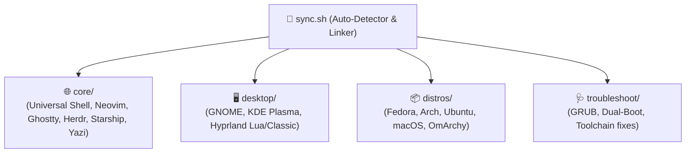

<h1 align="center">🚀 archConfig</h1>

<p align="center">
  <a href="https://github.com/Codesmith28/archConfig"></a>
  <a href="file:///home/codesmith28/archConfig/desktop"></a>
  <a href="file:///home/codesmith28/archConfig/core/config/nvim"></a>
  <a href="file:///home/codesmith28/archConfig/core/config"></a>
</p>

<h3 align="center"><em>Distros change, muscle memory shouldn't. Started on Arch, built for everywhere.</em></h3>

<p align="center">
A unified, modular, zero-drift dotfiles and bootstrap system delivering an identical developer experience across <b>Arch Linux</b>, <b>Fedora</b>, <b>Ubuntu</b>, and <b>macOS</b>.
</p>

---

## 🏗️ Layered Architecture

The repository decouples universal tools from desktop environments, distro-specific package installers, and recovery runbooks:

<div align="center">



</div>

* **[`core/`](file:///home/codesmith28/archConfig/core)** — Universal app configs (`nvim`, `ghostty`, `herdr`, `yazi`, `starship`), shell dotfiles, and automated setup.
* **[`desktop/`](file:///home/codesmith28/archConfig/desktop)** — Modular DE configurations for GNOME (dconf/extensions), KDE Plasma, and Hyprland.
* **[`distros/`](file:///home/codesmith28/archConfig/distros)** — Distro-native package installation, systemd services, and hardware optimizations.
* **[`troubleshoot/`](file:///home/codesmith28/archConfig/troubleshoot)** — Self-contained recovery guides & executable repair scripts for GRUB, dual-boot, and compilers.
* **[`.agents/skills/`](file:///home/codesmith28/archConfig/.agents/skills)** — Guardian skill (`archconfig-guard`) preventing multi-distro breakage.

---

## ⚡ Quick Start

### 1. Clone the repository
```bash
git clone --depth 1 https://github.com/Codesmith28/archConfig.git ~/archConfig
cd ~/archConfig
```

### 2. Synchronize dotfiles
> [!IMPORTANT]
> **Zero configuration required**: `./sync.sh` automatically detects your operating system (`Arch`, `Fedora`, `Ubuntu`, `macOS`) and active desktop environment (`GNOME`, `KDE`, `Hyprland`, or headless).

```bash
# Preview changes safely without touching files
./sync.sh --dry-run

# Run auto-detection & link dotfiles
./sync.sh
```

<details>
<summary><b>🔧 Need manual overrides? (Click to expand)</b></summary>

Override detection when configuring a secondary environment or container:
```bash
# Fedora Workstation with GNOME
./sync.sh --distro fedora --de gnome

# Arch Linux with Hyprland
./sync.sh --distro arch --de hyprland

# macOS Terminal Workstation
./sync.sh --distro mac --de none
```
</details>

---

## 🛠️ Developer Toolchains & Features

* 🚀 **Dynamic C++26 Discovery**: Auto-detects the newest installed GCC/G++ across Linux and macOS Homebrew, exports `$CC`/`$CXX`, and provides `run_cpp` for instant builds.
* ⚡ **Unified LazyVim**: Out-of-the-box LSP support for Python (`pyrefly`), C/C++ (`clangd`), dynamic JDK resolution (`resolve_java_home()`), and competitive programming test runner.
* 🔐 **Isolated Multi-Profile Git & SSH**: Automatically rewrites HTTPS to SSH and scopes identities (e.g. work vs personal) by directory without credential leaks (`core/scripts/setup_git.sh`).
* 🐚 **Modern Shell Stack**: Unattended bootstrap for `zoxide`, `fzf`, `yazi`, `starship`, and `vim-plug` without dirtying tracked files (`core/setup.sh`).

---

## 📦 Distribution Bootstrapping

Run native system package installers and hardware drivers on clean machines:

* **Fedora**: `cd distros/fedora && bash setup.sh` — DNF packages, RPM Fusion, developer toolchains, and NVIDIA configuration.
* **Arch Linux**: `cd distros/arch && bash setup.sh` — Pacman packages, AUR helper setup, and system services.
* **Ubuntu**: `cd distros/ubuntu && bash setup.sh` — APT dependencies, PPA repositories, and desktop optimizations.
* **macOS**: `cd distros/mac && bash setup.sh` — Homebrew bundle, CLI utilities, and cask applications.

---

## 🩺 Troubleshooting Runbooks

* 🐧 **[KDE Plasma Setup Guide](file:///home/codesmith28/archConfig/troubleshoot/kde_plasma_cross_distro_setup.md)**: Fix shortcut persistence (`kglobalshortcutsrc`), Plasma 6 migration, and window routing.
* 🎨 **[GNOME Setup Guide](file:///home/codesmith28/archConfig/troubleshoot/gnome_cross_distro_setup.md)**: Fix DBus session attachment, GSettings compilation, and Ubuntu dock collisions.
* 🥾 **[GRUB Recovery Guide](file:///home/codesmith28/archConfig/troubleshoot/restore_grub.md)** & **[Auto-Repair Script](file:///home/codesmith28/archConfig/troubleshoot/restoreGrub.sh)**: Restore EFI boot entries and dual-boot entries after Windows updates.
* 🍎 **[macOS `<bits/stdc++.h>` Fix](file:///home/codesmith28/archConfig/troubleshoot/fix_bits_stdcxx_macos.md)**: Resolve missing C++ bits headers on Darwin for competitive programming.

---

## 🤖 AI Assistant Guidelines

* Controlled by [archconfig-guard](file:///home/codesmith28/archConfig/.agents/skills/archconfig-guard) to enforce cross-platform compatibility rules.
* Never hardcodes compiler versions or platform-exclusive commands in `core/`.
* For historical context and design decisions, see [MIGRATION.md](file:///home/codesmith28/archConfig/MIGRATION.md).
