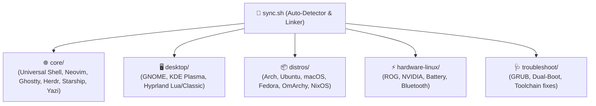

<h1 align="center">🚀 archConfig</h1>

<p align="center">
  <a href="https://github.com/Codesmith28/archConfig"></a>
  <a href="file:///home/codesmith28/archConfig/desktop"></a>
  <a href="file:///home/codesmith28/archConfig/core/config/nvim"></a>
  <a href="file:///home/codesmith28/archConfig/core/config"></a>
</p>

<h3 align="center"><em>Distros change, muscle memory shouldn't. Started on Arch, built for everywhere.</em></h3>

<p align="center">
A unified, modular, zero-drift dotfiles and bootstrap system delivering an identical developer experience across <b>Arch Linux</b>, <b>Ubuntu</b>, <b>macOS</b>, <b>Fedora</b>, and <b>NixOS</b>.
</p>

---

## 🏗️ Layered Architecture

The repository decouples universal tools from desktop environments, distro-specific package installers, and recovery runbooks:

<div align="center">



</div>

* **[`core/`](file:///home/codesmith28/archConfig/core)** — Universal app configs (`nvim`, `ghostty`, `herdr`, `yazi`, `starship`), shell dotfiles, and automated setup.
* **[`desktop/`](file:///home/codesmith28/archConfig/desktop)** — Modular DE configurations for GNOME (dconf/extensions), KDE Plasma, and Hyprland.
* **[`distros/`](file:///home/codesmith28/archConfig/distros)** — Distro-native package installation, systemd services, declarative NixOS Flake & Home Manager modules, and hardware optimizations.
* **[`hardware-linux/`](file:///home/codesmith28/archConfig/hardware-linux)** — Hardware-specific optimizations for Linux (ASUS ROG & NVIDIA power profiles, battery thresholds, Bluetooth).
* **[`troubleshoot/`](file:///home/codesmith28/archConfig/troubleshoot)** — Self-contained recovery guides & executable repair scripts for GRUB, dual-boot, and compilers.
* **[`.agents/skills/`](file:///home/codesmith28/archConfig/.agents/skills)** — Guardian skill (`archconfig-guard`) preventing multi-distro breakage.

---

## ⚡ Quick Start

### 1. Clone the repository
```bash
git clone --depth 1 https://github.com/Codesmith28/archConfig.git ~/archConfig
cd ~/archConfig
```

### 2. Synchronize dotfiles
> [!IMPORTANT]
> **Zero configuration required**: `./sync.sh` automatically detects your operating system (`Arch`, `Ubuntu`, `macOS`, `Fedora`, `NixOS`) and active desktop environment (`GNOME`, `KDE`, `Hyprland`, or headless).

```bash
# Preview changes safely without touching files
./sync.sh --dry-run

# Run auto-detection & link dotfiles
./sync.sh
```

<details>
<summary><b>🔧 Need manual overrides? (Click to expand)</b></summary>

Override detection when configuring a secondary environment or container:
```bash
# Arch Linux with Hyprland
./sync.sh --distro arch --de hyprland

# Ubuntu with GNOME
./sync.sh --distro ubuntu --de gnome

# macOS Terminal Workstation
./sync.sh --distro mac --de none

# Fedora Workstation with GNOME
./sync.sh --distro fedora --de gnome
```
</details>

---

## 🛠️ Developer Toolchains & Features

* 🚀 **Dynamic C++26 Discovery**: Auto-detects the newest installed GCC/G++ across Linux and macOS Homebrew, exports `$CC`/`$CXX`, and provides `run_cpp` for instant builds.
* ⚡ **Unified LazyVim**: Out-of-the-box LSP support for Python (`pyrefly`), C/C++ (`clangd`), dynamic JDK resolution (`resolve_java_home()`), and competitive programming test runner.
* 🔐 **Isolated Multi-Profile Git & SSH**: Automatically rewrites HTTPS to SSH, scopes identities by directory, and isolates credentials in `~/.gitconfig.local` via template (`core/home/.gitconfig.local.template` / `core/scripts/setup_git.sh`).
* 🐚 **Modern Shell Stack**: Unattended bootstrap for `zoxide`, `fzf`, `yazi`, `starship`, and `vim-plug` without dirtying tracked files (`core/setup.sh`).

---

## 📦 Distribution Bootstrapping

Run native system package installers and hardware drivers on clean machines:

* **Arch Linux**: `cd distros/arch && bash setup.sh` — Pacman packages, AUR helper setup, and system services.
* **Ubuntu**: `cd distros/ubuntu && bash setup.sh` — APT dependencies, PPA repositories, and desktop optimizations.
* **macOS**: `cd distros/mac && bash setup.sh` — Homebrew bundle, CLI utilities, and cask applications.
* **Fedora**: `cd distros/fedora && bash setup.sh` — DNF packages, RPM Fusion, developer toolchains, and NVIDIA configuration.
* **NixOS**: Fully declarative system and user deployment using Flakes and Home Manager (`distros/nixos/`):
  ```bash
  # 1. Copy installer hardware config & initialize local user config
  cp /etc/nixos/hardware-configuration.nix distros/nixos/hosts/default/hardware-configuration.nix
  cp distros/nixos/user-config.nix.template distros/nixos/user-config.nix

  # 2. Deploy system and user environment
  sudo nixos-rebuild switch --flake ./distros/nixos
  # Or via Bun: cd distros/nixos && bun run switch
  ```

---

## ❄️ Declarative NixOS Architecture & Deployment

NixOS configurations reside in [`distros/nixos`](file:///home/codesmith28/archConfig/distros/nixos) and provide a completely declarative, reproducible system and user environment.

### Quick Start: Deployment Workflow

1. **Hardware Configuration Prerequisite**:
   Copy the installer-generated hardware scan into your target host folder:
   ```bash
   cp /etc/nixos/hardware-configuration.nix distros/nixos/hosts/default/hardware-configuration.nix
   ```

2. **Configure User & Git Identity**:
   ```bash
   # Set local username and hostname for NixOS
   cp distros/nixos/user-config.nix.template distros/nixos/user-config.nix

   # Set personal Git identity
   cp core/home/.gitconfig.local.template ~/.gitconfig.local
   ```
   Both files are gitignored to keep credentials private.

3. **Deploy System & Home Manager**:
   ```bash
   sudo nixos-rebuild switch --flake ./distros/nixos
   # Or via Bun:
   cd distros/nixos && bun run switch
   ```

### Module Architecture
* **[`flake.nix`](file:///home/codesmith28/archConfig/distros/nixos/flake.nix)** — Flake defining dynamic host configurations (`nixosConfigurations`), pinning `nixpkgs` (`nixos-unstable`) and integrating Home Manager.
* **[`user-config.nix.template`](file:///home/codesmith28/archConfig/distros/nixos/user-config.nix.template)** — Tracked template for local username and hostname defaults.
* **[`package.json`](file:///home/codesmith28/archConfig/distros/nixos/package.json)** — Concise task runner scripts (`bun run switch`, `boot`, `test`, `update`, `check`, `clean`).
* **[`hosts/default`](file:///home/codesmith28/archConfig/distros/nixos/hosts/default)** — Hardware and system layout with ASUS ROG & NVIDIA RTX profile.
* **[`modules/system`](file:///home/codesmith28/archConfig/distros/nixos/modules/system)** — Boot (Linux 6.12+), NetworkManager, D-Bus, locale, fonts, and dynamic primary user.
* **[`modules/hardware`](file:///home/codesmith28/archConfig/distros/nixos/modules/hardware)** — ASUS asusd, NVIDIA PRIME offload, Bluetooth AX211 quirks, PipeWire, 85% battery threshold, and USB wake isolation.
* **[`modules/desktop`](file:///home/codesmith28/archConfig/distros/nixos/modules/desktop)** — GNOME and Hyprland (UWSM + portal).
* **[`home`](file:///home/codesmith28/archConfig/distros/nixos/home)** — Declarative Home Manager toolchains (`pkgs.texliveMedium`, CLI utilities), out-of-store symlinks, and shell aliases (`nrs`, `nrb`, `nrt`, `nfu`, `nfc`, `nix-clean`).

### Why Home Manager Manages NixOS Dotfiles
In [`distros/nixos/home/links.nix`](file:///home/codesmith28/archConfig/distros/nixos/home/links.nix), configs are linked via `config.lib.file.mkOutOfStoreSymlink` to `~/archConfig/core/config/` and `~/archConfig/core/home/`.
* **Single Source of Truth**: Universal configs remain in `core/` across all platforms.
* **Immediate Live Editing**: Out-of-store symlinks allow editing dotfiles in `core/` without rebuilding NixOS.
* **Secret Isolation**: Host-specific secrets (`~/.gitconfig.local`, `~/.wakatime.cfg.local`) are excluded from Home Manager to prevent secret leaks into the `/nix/store`.

### Why `sync.sh` is Guarded on NixOS
On NixOS, Home Manager declaratively owns user dotfile links. Running imperative link scripts would conflict with the Home Manager generation store. `sync.sh` automatically detects NixOS, informs the user to rebuild via Flake, and exits safely with 0.

---

## 🩺 Troubleshooting Runbooks

* 🐧 **[KDE Plasma Setup Guide](file:///home/codesmith28/archConfig/troubleshoot/kde_plasma_cross_distro_setup.md)**: Fix shortcut persistence (`kglobalshortcutsrc`), Plasma 6 migration, and window routing.
* 🎨 **[GNOME Setup Guide](file:///home/codesmith28/archConfig/troubleshoot/gnome_cross_distro_setup.md)**: Fix DBus session attachment, GSettings compilation, and Ubuntu dock collisions.
* ⚡ **[Cardwire & NVIDIA GPU Power Guide](file:///home/codesmith28/archConfig/troubleshoot/cardwire_gpu_power_management.md)**: Fix GPU isolation, runtime D3cold power management, and hybrid power profiles.
* 🥾 **[GRUB Recovery Guide](file:///home/codesmith28/archConfig/troubleshoot/restore_grub.md)** & **[Auto-Repair Script](file:///home/codesmith28/archConfig/troubleshoot/restoreGrub.sh)**: Restore EFI boot entries and dual-boot entries after Windows updates.
* 🍎 **[macOS `<bits/stdc++.h>` Fix](file:///home/codesmith28/archConfig/troubleshoot/fix_bits_stdcxx_macos.md)**: Resolve missing C++ bits headers on Darwin for competitive programming.

---

## 🤖 AI Assistant Guidelines

* Controlled by [archconfig-guard](file:///home/codesmith28/archConfig/.agents/skills/archconfig-guard) to enforce cross-platform compatibility rules.
* Never hardcodes compiler versions or platform-exclusive commands in `core/`.
